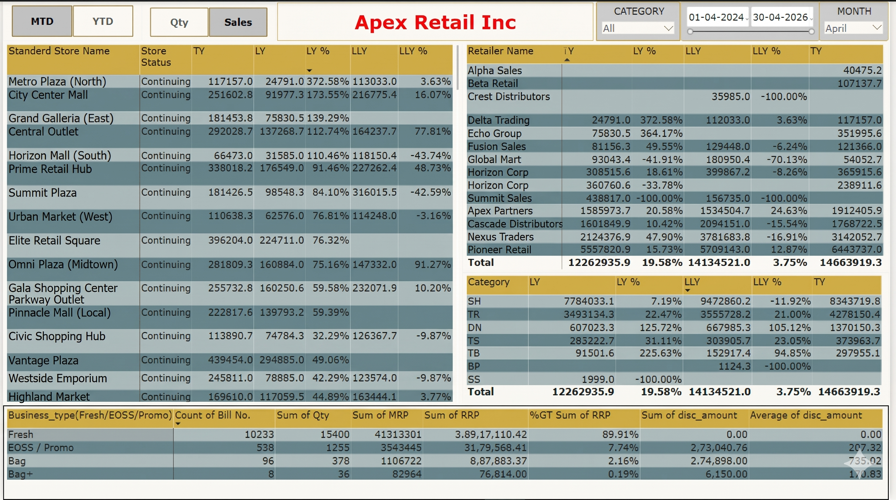

# Retail Sales Matrix Dashboard (Power BI)

An **Excel & Pivot-Table-inspired Power BI dashboard** built for retail operations, merchandising, and finance teams who prefer high-density, scannable tabular views over chart-heavy reports—combining the familiarity of spreadsheets with automated multi-year DAX comparisons.

> **Confidentiality & Data Notice:** To protect client privacy and commercial confidentiality, all brand names, store locations, retail partner names, and displayed figures in this showcase have been morphed and anonymized. The layout, data model logic, and interactive functionality remain identical to the production deliverable.

---

## Why This Layout?
Many retail and finance stakeholders immediately export BI dashboards into Excel because they need to scan exact store-level and retailer-level numbers side by side. This report bridges that gap by delivering a clean, spreadsheet-style matrix interface with instant one-click slicing—eliminating manual pivot table refreshes while preserving executive-level visibility.

---

## Key Features & Analytical Views

### 1. Dynamic Slicers & Metric Toggles
* **Timeframe Toggle:** Switch seamlessly between **MTD** (Month-to-Date) and **YTD** (Year-to-Date) views.
* **Metric Toggle:** Flip the entire report between **Sales** and **Quantity (Qty)** without leaving the page.
* **Granular Filters:** Slice across **Category**, **Month**, and custom **Date Ranges** with automated recalculation across all matrices.

### 2. Three-Year Comparative Matrices (`TY` vs. `LY` vs. `LLY`)
Side-by-side tracking of **This Year (`TY`)**, **Last Year (`LY`)**, and **Last-to-Last Year (`LLY`)** alongside automated YoY growth percentages (`LY %`, `LLY %`) across three operational levels:
* **Store-Level Performance:** Tracks individual store status (`Continuing`) and multi-year sales/quantity variance.
* **Retailer-Level Summary:** Aggregates performance across key retail partner accounts with dynamic grand totals.
* **Category Breakdown:** Compares product category performance (`SH`, `TR`, `DN`, `TS`, `TB`, `BP`, `SS`) against prior-year benchmarks.

### 3. Promotional & Discount Audit
A dedicated bottom summary matrix breaking down sales by business type (**Fresh**, **EOSS / Promo**, **Bag**, **Bag+**) across:
* **Volume & Billing:** `Count of Bill No.` and `Sum of Qty`
* **Pricing & Revenue Mix:** `Sum of MRP`, `Sum of RRP`, and `%GT Sum of RRP`
* **Discount Impact:** `Sum of disc_amount` and `Average of disc_amount`

---

## Tech Stack & Implementation
* **BI Platform:** Microsoft Power BI
* **Data Modeling:** Star-schema dimensional model
* **DAX & Interactivity:** Time-intelligence measures (`TY`, `LY`, `LLY`, `MTD`, `YTD`), YoY variance calculations, and dynamic field-parameter toggles for `Sales` vs. `Qty`
